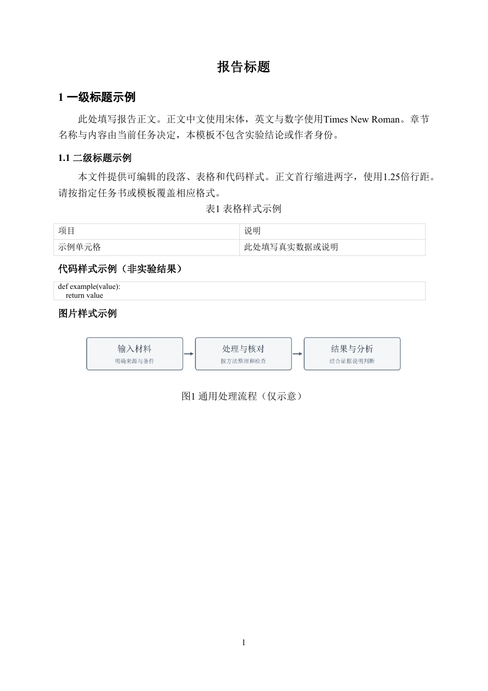

# AwesomeReport

中文实验与技术实践报告技能。新版`lab-report-zh`包含通用写作规范、标准Word模板和自动排版脚本，依据当前任务的真实材料生成可编辑报告。

## 使用技能

将整个`lab-report-zh/`复制到工作区的`.agents/skills/`，或让agent直接读取[SKILL.md](lab-report-zh/SKILL.md)。只复制这个技能目录即可，不需要带其他工作区的实验、身份或配置。

> 使用$lab-report-zh，依据当前任务要求、模板和真实材料制作报告；没有指定版式时使用内置标准Word模板，生成后检查目录和所有页面。

## 模板

- [标准Word模板](lab-report-zh/assets/standard-report.docx)：直接编辑或自动生成，含正文、标题、表格、代码和页码样式。
- [原始数模模板](lab-report-zh/assets/数学建模国赛标准论文Word模板.doc)：**只参考格式，忽略内容**。不把数模题目、模型、案例、数据、结论、参考文献及“不要目录”等专用要求带进新报告。
- [模板来源与调整](lab-report-zh/references/template-provenance.md)：记录数模来源、参数和为通用报告做的修改。

默认正文宋体12pt，英文数字Times New Roman，一级标题黑体14pt加粗，二级标题宋体12pt加粗；正文首行24pt、1.25倍行距。表格10.5pt，代码9.5pt。A4、四边2.5cm页边距。**当前任务要求或指定模板优先。**章节数量、作者、编号和日期均不预设。



模板包含图片与图题示例。[完整样稿输入](lab-report-zh/examples/report.json)进一步展示任务说明、流程图、核心代码、结果对照表及分析段落，可用下方命令生成Word。流程图和待测表格仅演示写法，不是实验记录。

## 自动排版

需要Python 3.10+。在`lab-report-zh`目录执行：

```powershell
python -m pip install -r requirements.txt
python scripts/format_report.py --input examples/report.json --output output/report.docx
```

JSON支持标题、正文、代码、数据表、图片和显式分页，可选封面与目录。正文由当前任务提供；排版器不生成实验结论，不解析Markdown或数学公式。

Windows安装Word时更新目录、页码并导出PDF：

```powershell
powershell -NoProfile -File scripts/export_word.ps1 -DocumentPath output/report.docx
```

该命令会保存Word文件并覆盖同名PDF，应对备份后的工作副本运行。其他环境可选择可用转换器并核对字体及分页。

静态检查与自动测试：

```powershell
python scripts/audit_report.py output/report.docx
python -m unittest discover -s tests -v
```

静态检查不代表视觉验收。交付前须逐页查看导出页面，核对图表、代码、目录、字体、裁切和空白。

完整参数和输入格式见[自动排版说明](lab-report-zh/references/自动排版.md)。`--template`指定其他Word模板，默认保留其样式；只有显式`--style-config`才覆盖样式。生成器创建新报告，不对用户现有报告正文就地排版；输出已存在时默认拒绝替换。

## 内容与证据

报告应能独立阅读，清楚说明方法、实际结果和限制。保留用户手工修改、原始截图及日志；区分预期与实测、提交与验收，不虚构通过状态。见[制作规范](lab-report-zh/references/制作规范.md)。

## 历史版本

`word-experiment-report/`为早期工作区型技能，保留以兼容旧用法。新报告推荐使用独立的`lab-report-zh/`，避免将旧工作区材料带到新任务。

本次迭代见[CHANGELOG.md](CHANGELOG.md)。
